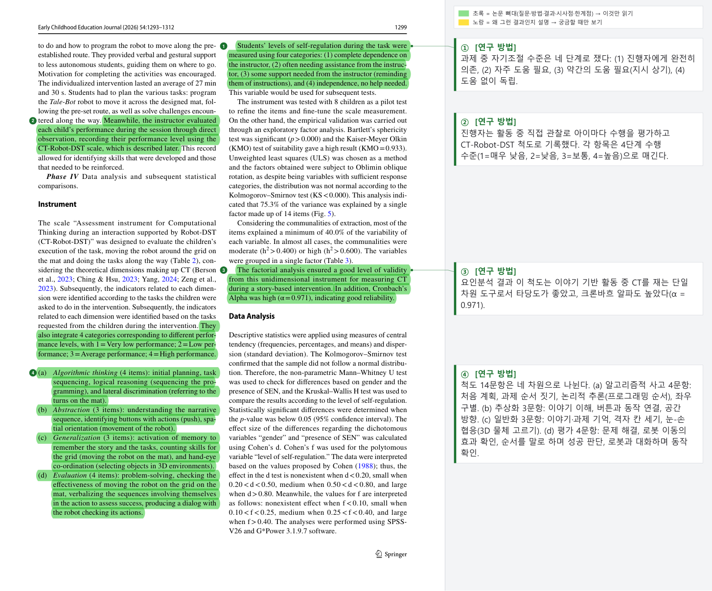
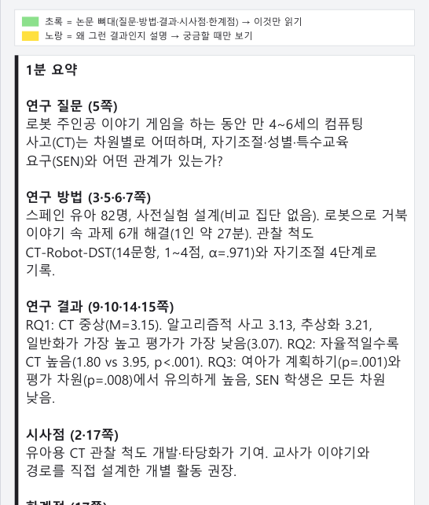

# paper-highlight-ko — 해외 논문 형광펜 + 한글 번역

해외 논문 PDF를 넣으면 **중요한 문장에 형광펜**을 칠하고, 그 옆에 **한글 번역을 항상 띄워 둔** PDF를 만들어 주는 Claude Code 스킬입니다.
번역기를 왔다 갔다 하지 않고, 형광펜과 번역만 읽어도 논문의 중요한 내용을 정확하게 파악할 수 있게 하는 것이 목표입니다.



## 무엇을 해 주나요?

- 🟩 **초록 형광펜 = 논문 뼈대**: 연구 질문 · 연구 방법 · 연구 결과 · 시사점 · 한계점
  - 연구 질문이 여러 개면 `연구 질문 RQ1`, `연구 결과 RQ1`처럼 짝을 지어 줍니다.
  - 결과는 방향뿐 아니라 크기와 유의 여부까지 담고, 유의하지 않은 결과도 빼지 않습니다.
- 🟨 **노랑 형광펜 = 왜 그런 결과가 나왔는지** 저자가 설명한 문장
- **오른쪽 번역 칸**: 형광펜과 같은 높이에 한글 번역이 항상 보입니다. 번호(①②…)와 선으로 이어집니다.
- **1쪽에 1분 요약**: 다섯 가지를 한 줄씩, 쪽 번호와 함께 보여 줍니다.
- 번역 글씨는 쪽마다 겹치지 않는 범위에서 가장 크게(최대 11pt) 자동으로 맞춥니다.
- 결과는 원본 옆에 `원본이름_형광펜.pdf`로 저장되며, 원본은 그대로 둡니다. Zotero·엣지·아크로뱃·인쇄 어디서나 보입니다.



## 어떻게 고르나요? (정확도를 위한 검증)

문장을 훑어서 고르지 않습니다. 매번 이렇게 진행합니다.

1. 논문 전문을 끝까지 읽고 **꼭 알아야 할 내용 목록**을 먼저 만듭니다.
2. 그 목록이 다 담기도록 형광펜을 고릅니다.
3. **눈가림 검증**: 원문을 본 적 없는 새 독자(서브에이전트)가 형광펜 번역과 1분 요약만 읽고 이해 질문 12개에 답합니다.
4. 원문과 대조해 채점하고, 잘못 이해했거나 빠진 곳이 있으면 저자 문장을 보태 고칩니다.
5. **잘못 이해한 곳이 0개**가 될 때까지 반복한 뒤 PDF를 만듭니다.

저자가 쓰지 않은 내용(AI의 비판·해석)은 넣지 않습니다.

## 설치

Claude Code에서 아래 두 줄을 차례로 입력하세요.

```
/plugin marketplace add yskang918/paper-highlight-ko
/plugin install paper-highlight-ko@paper-highlight-ko
```

플러그인을 쓰지 않고 직접 넣으려면, 이 저장소의 `skills/paper-highlight-ko` 폴더를 `~/.claude/skills/` 아래에 복사하면 됩니다.

### 필요한 것

- 파이썬 3
- PyMuPDF (`python -m pip install pymupdf`) — 없으면 Claude가 설치를 안내합니다.
- 한글 글꼴은 자동으로 찾습니다(윈도우 맑은 고딕, 맥 애플고딕, 리눅스 나눔·Noto). 없으면 PyMuPDF에 들어 있는 한글 글꼴을 씁니다.

## 사용법

Claude Code에 PDF를 끌어다 놓거나 경로를 붙여 넣고 이렇게 말하면 됩니다.

```
이 논문 형광펜 칠해줘
```

`/paper-highlight-ko` 를 입력하고 PDF 경로를 붙여도 됩니다. 여러 편을 한 번에 맡길 수도 있습니다.

## 알아 두세요

- 검증 과정 때문에 한 편에 몇 분이 걸립니다.
- 스캔한 PDF(글자를 선택할 수 없는 PDF)는 지원하지 않습니다.
- 번역과 분류는 AI가 합니다. 논문에 인용할 때는 꼭 원문을 확인하세요.
- 표에만 있고 본문에 없는 숫자는 형광펜으로 담기지 않을 수 있습니다.

## 예시 그림 출처

`docs/` 의 예시 그림은 아래 논문(CC BY 4.0)에 이 스킬로 형광펜과 번역을 더한 화면입니다.
M. Esther-del-Moral-Pérez, Nerea López-Bouzas, Jonathan Castañeda-Fernández (2026). Game-Based Storytelling with a Robot Character: Activating Computational Thinking in Young Children. *Early Childhood Education Journal*, 54, 1293–1312. https://doi.org/10.1007/s10643-025-01930-x

## 라이선스

MIT
